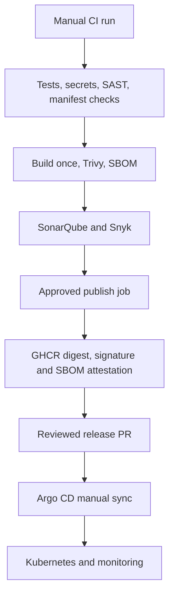

# DevOps Platform Toolkit

**Check a Kubernetes release, understand an incident, and recover an explicitly approved failure.**

Use this when you are about to deploy and want one readable answer to: **what is missing, what could reduce availability, and what recovery is actually approved?** During an incident, collect evidence and build a timeline rather than repeating the same investigation commands.

**Status: development version `0.3.0.dev0`.** Features, regression cases and demo workflows are included. Tests, package installation/build, scanners, notification delivery and live recovery have **not been run** for this revision. Nothing is deployed or enabled. This is not a production-validated auto-healer.

## Start here — no cluster needed

Get a readable result before connecting any infrastructure:

```bash
# After the source installation below:
devops-toolkit doctor
mkdir -m 700 private-reports
devops-toolkit example --scenario crash --output private-reports/example.json
devops-toolkit report private-reports/example.json --output private-reports/example.html
```

Open `private-reports/example.html` locally. It explains a **fabricated example**, evidence and next steps. Nothing contacts a cluster or performs a repair. Use `devops-toolkit guide` for an interactive command planner; it prints a command for review and never executes it.

**[Follow the short walkthrough](docs/easy-start.md)** · [Reports and handovers](docs/reports.md) · [GitOps proposals](docs/gitops-proposals.md)

| Make everyday work easier | What you get |
| --- | --- |
| `doctor` | Prerequisite explanations; cluster authorization checks only with an explicit context |
| `guide` | Task selection and prompts instead of memorizing flags; review before running |
| `diagnose --format text` | Symptoms, evidence, uncertainty and suggested safe next reads |
| `example` | Offline crash, image-pull and selector learning examples |
| `report` | Standalone local HTML, Markdown or summary JSON from saved evidence |
| `handover` | Ticket/shift draft with owner, impact and update-time fields to complete |
| `gitops-propose` | Local image-only source patch and review notes for your normal GitOps PR process |

Existing snapshots, comparisons, timelines, alerts and CI integrations are retained. Reports can show observed changes and scoped repair audit outcomes; they do not infer root cause or business recovery. No ticket, message, PR or deployment is created by these new usability commands. **Installation, runtime behavior and usability remain unverified.**

## Use it in your normal delivery workflow

| Need | Command or integration | What happens |
| --- | --- | --- |
| Automatic pull-request feedback | **Toolkit configuration checks** GitHub workflow | Offline regression/configuration checks, PR check summary and report artifact; no cluster credentials |
| Existing YAML or Helm chart | `manifest-check` / `release-check --file` or `--chart` | Direct YAML/JSON input or bounded local Helm rendering |
| Explain Git-versus-cluster drift | `drift` | Changed desired-field paths; values are redacted and nothing is reconciled |
| Validate a repair without saving it | `repair-dry-run` | Kubernetes server-side dry-run of the approved patch; no persisted latch or rollout |
| Troubleshoot one application | `bundle` | Private evidence selected through Deployment → ReplicaSet → Pod ownership |
| Trusted live CI gate | Optional Jenkins stage | Explicit context, approved credential and private report destination; disabled by default |

Automatic offline checks are configured for future matching PRs/main pushes. **This code-only update is marked `[skip ci]` to honor the instruction not to run anything yet. No successful CI run is claimed.** Existing image publication, security/release gates and deployment approvals remain separate and manual.

[CI/CD integration and trust boundaries](docs/ci-integration.md) · [YAML/Helm input](docs/manifest-input.md)

## Why a DevOps engineer would use it

| Your question | What the toolkit checks | Important boundary |
| --- | --- | --- |
| Does this image exist? | Digest and registry access | Local registry identity; not a signature or node-pull guarantee |
| Are Secrets and ConfigMaps available? | Required live objects and keys | No values in reports; proposed same-release objects are not assumed present |
| Can a new pod fit? | Estimated CPU/memory headroom | One pod; not full rollout, quotas or scheduler simulation |
| Will the Service select these pods? | Candidate labels, selectors and named ports | No proof of exclusive selection or real traffic |
| Could this reduce availability? | Recreate, maxUnavailable, downscale, readiness and live baseline | Configuration risks, not an outage prediction |
| What recovery is approved? | Policy expiry, scope, UID, candidate hash and opt-in | No policy means no approved direct recovery |

The report says **BLOCKED**, **NEEDS_REVIEW** or **CHECKS_PASSED**, with evidence. Missing access, skipped checks and uncertainty stay visible. Passing implemented checks is not deployment approval.

## Install the CLI when you are ready

From this repository, using Python 3.12 or later:

```bash
python -m venv .venv
. .venv/bin/activate
python -m pip install '.[yaml]'
```

Then use `devops-toolkit ...`. Installation is supplied as source configuration and remains unverified; no package is published to PyPI. All commands also work from the repository as `python -m devops_toolkit ...`, without installing the CLI package. The base JSON CLI uses the standard library; the optional YAML extra installs pinned PyYAML. Cluster reads need kubectl; image checks need Docker; direct chart input needs local Helm.

## A practical workflow

### 1. Check a release without deploying it

```bash
mkdir -p reports
devops-toolkit release-check --context YOUR_CONTEXT --namespace platform \
  --deployment YOUR_DEPLOYMENT --service YOUR_SERVICE \
  --file k8s/release.yaml --format text --output reports/release-check.json
```

Input can be JSON, multi-document Kubernetes YAML or a trusted local Helm chart. Omit `--file` to inspect the live Deployment. Supply `--policy` if you have a reviewed recovery approval. Use `--chart ./charts/my-app --release my-app --values values/staging.yaml` instead of `--file` for local Helm rendering. [Read the six checks and limits](docs/release-check.md).

### 2. Generate a policy without copying IDs or hashes

Supply a reviewed JSON correction, such as container names mapped to known compatible image digests:

```bash
devops-toolkit policy create --context YOUR_CONTEXT --namespace platform \
  --kind Deployment --name YOUR_DEPLOYMENT --action images \
  --approved approved-images.local.json --output reports/recovery-policy.local.json
```

The generator reads live identities and hashes for you. It requires the workload's existing opt-in and preserves repair guards. It does not invent a fix or enable automation. [Examples for all four actions](docs/policies.md).

### 3. Recover only after explicit enabling

```bash
devops-toolkit watch-recovery --policy reports/recovery-policy.local.json \
  --execute --audit reports/recovery-UNIQUE-ID.jsonl
```

The image monitor waits for persistent failed-rollout evidence, makes one conditional repair and checks readiness. `repair` supports approved container fields, Service selector and upward replica restoration. Preview is the default. Scope, expiry, GitOps/HPA ownership checks, audit and attempt latches apply. Namespace pause and process stop controls are available. [Repair guide](docs/automatic-repair.md) · [Stop and permissions](docs/operations.md).

### 4. Understand what happened

```bash
devops-toolkit incident --context YOUR_CONTEXT --namespace platform --output reports/before
# Collect additional snapshots when appropriate, using new folders.
devops-toolkit timeline reports/before/report.json reports/after/report.json \
  --audit reports/recovery-UNIQUE-ID.jsonl --output reports/timeline.md
```

The timeline shows observed symptoms, differences and scoped repair events. It does not prove root cause. [Timeline guide](docs/timeline.md).

### 5. Receive optional outcome alerts

Add `--notify-config alerts.local.json` to an operational command. Configure Slack, Teams or a generic HTTPS receiver through a secret environment variable. Nothing is sent by default; sensitive reports and target identities are excluded from notifications. [Alert setup and delivery limits](docs/alerts.md).

## More everyday commands

```bash
# Offline configuration only: no live registry, Secret or capacity claims.
devops-toolkit manifest-check --file k8s/release.yaml --namespace platform \
  --output reports/configuration.json

# Compare desired fields to an explicitly selected live cluster.
devops-toolkit drift --context YOUR_CONTEXT --namespace platform \
  --file k8s/release.yaml --output reports/drift.json

# Ask the server to validate one approved repair without persisting it.
devops-toolkit repair-dry-run --policy reports/recovery-policy.local.json \
  --output reports/repair-dry-run.json

# Gather private evidence for this Deployment only; logs are off by default.
devops-toolkit bundle --context YOUR_CONTEXT --namespace platform \
  --deployment YOUR_DEPLOYMENT --output reports/workload-UNIQUE-ID
```

Use a new output file/directory and an existing private report parent. All these commands are read-only or non-persisting validation. A server dry-run still contacts the cluster and requires patch RBAC. Do not upload connected-cluster reports or bundles automatically.

[Drift scope](docs/drift.md) · [Dry-run behavior](docs/dry-run.md) · [Bundle contents and privacy](docs/bundle.md)

## See a repair on a disposable local cluster later

The code includes four scenarios:

```bash
devops-toolkit demo --scenario images
devops-toolkit demo --scenario selector
devops-toolkit demo --scenario replicas
devops-toolkit demo --scenario configuration
```

Each creates its own local kind cluster, introduces a known fault, attempts its approved correction, checks HTTP and audit evidence, writes a timeline and removes its cluster. It requires local Docker, kind and kubectl. These commands **create and delete local resources when run**. They are not being run as part of this update.

Or choose **Actions → Local recovery demo → Run workflow** and select one scenario. The workflow is manual only. **All four live scenarios remain unverified.** [Demo guide](docs/demo.md).

## Commands at a glance

| Command | Purpose | Changes cluster state? |
| --- | --- | --- |
| `doctor` / `guide` | Prerequisite checks / interactive command planning | No; doctor contacts cluster only with explicit context |
| `example` / `report` / `handover` | Offline learning, readable evidence and handover drafts | No cluster access |
| `gitops-propose` | Local image-only source proposal for review | No cluster or Git changes |
| `manifest-check` | Offline rendered configuration feedback for CI | No cluster access |
| `release-check` | Six live/candidate checks and one readable decision | No |
| `preflight` | Detailed configuration/reference/capacity checks | No |
| `diagnose` | Workload symptoms and suggested next actions | No |
| `policy create` / `policy check` | Generate private approval / validate offline | No |
| `incident` / `bundle` | Namespace snapshot / ownership-scoped workload evidence | No |
| `drift` | Desired-versus-live field paths | No |
| `repair-dry-run` | Server-side approved patch validation | No persisted changes |
| `compare` / `timeline` | Compare/correlate saved evidence offline | No |
| `recover` / `watch-recovery` | One approved image repair | Only with `--execute` |
| `repair` | Approved container, selector or replica correction | Only with `--execute` |
| `demo` | Disposable local recovery scenario | Yes, its newly created local cluster only |

## What it will not automatically fix

Application bugs, missing credentials, arbitrary network failures, storage corruption, node failures and control-plane disasters need an engineer or the owning platform controller. GitOps-managed resources should be repaired through approved Git state; direct repairs refuse recognized Argo CD/Flux ownership. An approved image correction is not a full revision or database rollback.

Read [all Kubernetes problem types](docs/kubernetes-problems.md), [compatibility/evidence](docs/compatibility.md), [contribution guide](CONTRIBUTING.md), [security reporting](SECURITY.md) and [changelog](CHANGELOG.md). The Flask API and infrastructure below remain the separate delivery/learning target.

## Delivery flow



The image/security/publication flow stays manual until initial validation is complete; automatic offline toolkit checks are configured separately. A check-only run does not publish. A release run requires SonarQube and Snyk to pass before the saved image is published. Missing credentials stop the release.

## Run locally

The dependency lock targets **CPython 3.12 on Linux amd64**. Docker Compose also selects amd64.

```bash
docker compose up --build -d
curl http://127.0.0.1:8080/
docker compose down
```

For a local Python environment:

```bash
python -m venv .venv
source .venv/bin/activate
make install
make run
```

Gunicorn serves the application with one process and four threads per pod. Request metrics are process-local; scale pods rather than increasing worker processes.

| Endpoint | Purpose |
| --- | --- |
| GET / | Service name and source version |
| GET /health/live | Process health |
| GET /health/ready | Service readiness |
| GET /metrics | Request counters and latency histogram |

The service is stateless and has no downstream dependency. Logs omit query strings and use matched routes to avoid logging arbitrary paths. Optional Ingress exposes only the exact root path; health and metrics stay internal.

## Project layout

| Path | Contents |
| --- | --- |
| devops_toolkit/ | Deployment checks, evidence, diagnosis and opt-in approved repairs |
| app/, tests/ | API and regression tests |
| ci/ | Shared checks used by GitHub Actions and Jenkins |
| .github/workflows/ | Check, release and reusable quality jobs |
| charts/platform/ | Helm chart and multi-zone deployment profile |
| gitops/ | Restricted Argo project and release configuration |
| infra/, ansible/ | Optional single-node AWS lab |
| monitoring/ | Scrape configuration, alerts and dashboard |
| docs/ | Setup, decisions, runbook, learning and review notes |

## Release controls

GitHub Actions is the publishing authority. Jenkins runs the same source, image and external quality checks, but does not publish.

Releases use:

- Hash-locked Python dependencies and digest-pinned base/tool images.
- Git-history scanning with Gitleaks and local Semgrep rules.
- Trivy and Snyk gates for high/critical container vulnerabilities.
- SonarQube analysis and a blocking quality gate.
- The same saved image archive across scanning and publication.
- Cosign keyless signing and an SBOM attestation on the registry digest.

Configure the GitHub `production` environment with required reviewers and main-only deployment rules. The workflow declaration alone does not enforce those account settings. Signature verification is a release-review step; cluster admission enforcement is not included.

## Deployment profiles

The default chart runs a small lab. The production profile requires an approved image digest, at least three eligible nodes across two zones, metrics-server and a NetworkPolicy-enforcing CNI. It adds strict placement and autoscaling; it does not provision that infrastructure.

Terraform and Ansible deliberately remain a **single-node lab**. They are not a production cluster or a free-cost guarantee. EC2, storage and public IPv4 may be billed.

Start with [the walkthrough](docs/start-here.md), [toolkit commands](docs/toolkit.md), [setup](docs/setup.md), [design decisions](docs/decisions.md), [runbook](docs/runbook.md), [learning](docs/learning.md), and [review findings](docs/review.md). [Deployment notes](docs/readiness.md) list the evidence still needed before production use.
