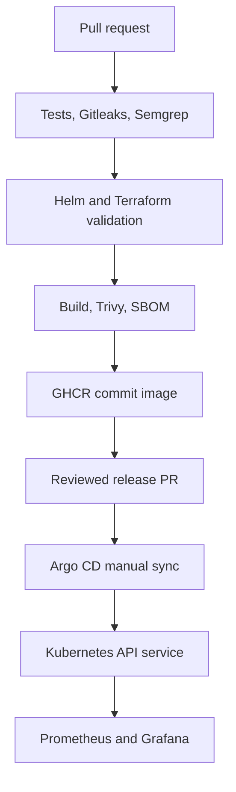

# DevOps Platform

A focused DevSecOps portfolio lab: take a small Python release-status API from a pull request to a scanned container and a reviewed Kubernetes release.

**Status:** implementation supplied; tests, scanner runs, image builds, Terraform validation and live deployment have not been executed. No AWS resources have been created. This is a personal lab, not evidence of commercial production experience.

## Architecture



GitHub Actions is the default CI runner. Jenkins is an alternative for practicing the same delivery flow; running both is unnecessary. SonarQube and Snyk have a separate manual workflow because they need external configuration. The standard CI does **not** imply those two gates passed.

## Local start

Requires Python 3.12, or Docker with Compose.

```bash
python -m app.server
# In a second terminal:
curl http://127.0.0.1:8080/
curl http://127.0.0.1:8080/health/ready
```

Or run `docker compose up --build -d`. The Compose port binds only to localhost. Stop with `docker compose down`.

Routes: `/` release identity, `/health/live` process health, `/health/ready` readiness, `/metrics` Prometheus availability gauge. The app has no external dependencies or database; readiness therefore checks only this service. Logs go to stdout.

## Verification when you are ready

```bash
python -m pip install -r requirements-dev.txt
coverage run --source=app -m unittest discover -s tests -v
coverage xml
coverage report --fail-under=80
```

CI is initially manual-only to respect the request not to run tests during creation. Once reviewed, enable push/PR triggers in `.github/workflows/ci.yml`. See [setup](docs/setup.md), [runbook](docs/runbook.md), [learning guide](docs/learning.md), and [design decisions](docs/decisions.md).

## What is included

| Component | Purpose |
| --- | --- |
| GitHub Actions / Jenkins | Test, scan, build and publish |
| Gitleaks | Scan Git history for secrets with redacted output |
| Semgrep | Local rule rejecting shell execution in Python |
| SonarQube | Code analysis, coverage and blocking quality gate |
| Trivy | Fail on fixable high/critical image findings; generate SBOM |
| Snyk | Additional authenticated container vulnerability scan |
| Helm | Rolling updates, probes, limits, restricted container, PDB |
| Argo CD | Explicit human sync from a reviewed release file |
| Terraform | Optional isolated AWS VPC and EC2 lab |
| Ansible | Versioned single-node k3s installation |
| Prometheus / Grafana | Scrape availability, CPU and an alert |

## Release contract

Publish a successful CI commit image. Set `gitops/release.yaml` to that full SHA through a PR. If claiming all security gates passed, run the external quality workflow on the **same SHA** and inspect its result before approving release. Argo CD watches main but does not auto-sync. Never deploy an empty tag or use `latest`.

The first GHCR package may be private even though this repository is public. Make the package public before deploying, or configure an image pull secret locally.

## Deployment safeguards

The Helm chart supports verified image digests, validates full commit tags, includes a startup probe and soft host spreading, and applies restrictive API network policies. Read [readiness and remaining work](docs/readiness.md) before deployment. These changes are untested.

## Boundaries

Single-node k3s is a cost-conscious lab, not a highly available production cluster. Two replicas on one node cannot survive node failure. No EKS control plane, NAT gateway, public ingress, database or cloud apply is enabled automatically. AWS EC2, storage and public IPv4 can incur charges; confirm your account eligibility before provisioning.

Tool versions are explicit where practical. Base image tags and some upstream CI references remain mutable; base-image/action SHA pinning and signature verification are improvements to make after a successful baseline run. Scanners can fail as vulnerability databases change. Do not bypass findings to obtain a green badge.
