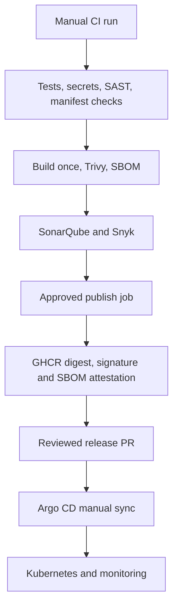

# DevOps Platform

A DevOps project that helps you **check deployments, diagnose Kubernetes problems, compare incident snapshots and recover approved failed image releases**. A small Flask API provides the delivery target, with security gates, signed images and GitOps deployment.

**Status:** Recovery code and mock test cases are included, but tests, scanner execution, image builds and live deployment/recovery validation remain pending. No cluster repair or AWS provisioning has been performed. This is not a production-validated auto-healer.

## Can it automatically fix Kubernetes problems?

**It can attempt one specific repair when you explicitly enable it:** restore approved container image digests after a Deployment rollout fails. It checks the target identity and failed template, records an audit trail, attempts one change and checks readiness. No repair runs by default. The new `watch-recovery` command can monitor one approved rollout and trigger recovery automatically when explicitly enabled.

For crashes, image pulls, memory failures, pending pods, storage, scaling and node symptoms, `diagnose` gives evidence and next actions. Networking, certificates, permissions and other complex incidents have documented investigation paths. **It cannot safely fix every Kubernetes problem.**

```bash
python -m devops_toolkit diagnose --context YOUR_CONTEXT --namespace platform
```

[Problem list and countermeasures](docs/kubernetes-problems.md) · [How to configure automatic image recovery](docs/recovery.md)

The repository's Argo CD-managed application must be repaired through Git. Direct recovery refuses recognized GitOps-managed workloads. Use a separately approved lab Deployment to validate this feature first. Unattended recovery is available through `watch-recovery` after you prepare a valid policy and enable execution. The monitor is not running or installed on any host or cluster.

### Automatic recovery after setup

Prepare the policy and workload opt-in using [the recovery guide](docs/recovery.md). Then start the monitor:

```bash
python -m devops_toolkit watch-recovery --policy /secure/recovery-policy.json \
  --execute --audit /secure/reports/recovery-UNIQUE-RUN-ID.jsonl
```

It watches only the exact approved workload and pod template. After three consecutive failed-rollout observations, it attempts one image repair and checks Deployment readiness. It stops on success, a changed or expired policy, an error, or the monitoring timeout. It does not repair arbitrary pod, network, storage or cluster failures. Tests and live recovery drills remain pending.

## What changed before the failure?

Save an incident snapshot before a release and another afterwards. Compare them to spot changed images, fewer ready replicas, increased restarts and newly captured warnings.

**Example:** a deployment had **3 ready replicas** before a release and **1 afterwards**, its image changed, and a container's restart counter increased. The tool highlights those differences so you know where to investigate. It does not claim the deployment caused the failure.

Try the included sample without a cluster or credentials:

```bash
python -m devops_toolkit compare examples/snapshots/before.json examples/snapshots/after.json
```

The sample data is illustrative, not real test evidence. To compare your own saved snapshots:

```bash
python -m devops_toolkit compare before/report.json after/report.json
```

| Command | When to use it | What you get |
| --- | --- | --- |
| `preflight` | Before deployment | Configuration findings and estimated capacity |
| `incident` | Before a release or during a problem | A private snapshot of the namespace |
| `compare` | After collecting two snapshots | A readable summary of observed changes |
| `diagnose` | During an incident | Symptoms, partial-data warnings and next actions |
| `recover` | After an approved failed image rollout | Preview by default; one guarded repair with `--execute` |
| `watch-recovery` | While an approved rollout is in progress | Monitor and automatically trigger one approved image recovery |

Comparison is offline and read-only. It requires only Python 3.12. Partial snapshots are flagged; a missing record is not automatically treated as a deleted resource.

## Start here

New to the project? Read [the simple walkthrough](docs/start-here.md).

### Check a deployment

```bash
python -m devops_toolkit preflight --context YOUR_CONTEXT --namespace platform
```

Checks image digests, resource settings, probes, required configuration and estimated capacity. It inspects the live Deployment unless you supply a proposed JSON manifest.

### Collect incident evidence

```bash
python -m devops_toolkit incident --context YOUR_CONTEXT --namespace platform
```

Creates a private local report with pod health, restarts, deployment state and event reasons. Logs are off by default. Preflight and incident collection are read-only and require Python 3.12, kubectl and authorized cluster access. Offline comparison needs neither kubectl nor cluster access.

[Commands, examples and explanations →](docs/toolkit.md)

## Delivery flow



CI stays manual until initial validation is complete. A check-only run does not publish. A release run requires SonarQube and Snyk to pass before the saved image is published. Missing credentials stop the release.

## Run locally

The dependency lock targets **CPython 3.12 on Linux amd64**. Docker Compose also selects amd64.

```bash
docker compose up --build -d
curl http://127.0.0.1:8080/
docker compose down
```

For a local Python environment:

```bash
python -m venv .venv
source .venv/bin/activate
make install
make run
```

Gunicorn serves the application with one process and four threads per pod. Request metrics are process-local; scale pods rather than increasing worker processes.

| Endpoint | Purpose |
| --- | --- |
| GET / | Service name and source version |
| GET /health/live | Process health |
| GET /health/ready | Service readiness |
| GET /metrics | Request counters and latency histogram |

The service is stateless and has no downstream dependency. Logs omit query strings and use matched routes to avoid logging arbitrary paths. Optional Ingress exposes only the exact root path; health and metrics stay internal.

## Project layout

| Path | Contents |
| --- | --- |
| devops_toolkit/ | Read-only deployment checks and incident evidence CLI |
| app/, tests/ | API and regression tests |
| ci/ | Shared checks used by GitHub Actions and Jenkins |
| .github/workflows/ | Check, release and reusable quality jobs |
| charts/platform/ | Helm chart and multi-zone deployment profile |
| gitops/ | Restricted Argo project and release configuration |
| infra/, ansible/ | Optional single-node AWS lab |
| monitoring/ | Scrape configuration, alerts and dashboard |
| docs/ | Setup, decisions, runbook, learning and review notes |

## Release controls

GitHub Actions is the publishing authority. Jenkins runs the same source, image and external quality checks, but does not publish.

Releases use:

- Hash-locked Python dependencies and digest-pinned base/tool images.
- Git-history scanning with Gitleaks and local Semgrep rules.
- Trivy and Snyk gates for high/critical container vulnerabilities.
- SonarQube analysis and a blocking quality gate.
- The same saved image archive across scanning and publication.
- Cosign keyless signing and an SBOM attestation on the registry digest.

Configure the GitHub `production` environment with required reviewers and main-only deployment rules. The workflow declaration alone does not enforce those account settings. Signature verification is a release-review step; cluster admission enforcement is not included.

## Deployment profiles

The default chart runs a small lab. The production profile requires an approved image digest, at least three eligible nodes across two zones, metrics-server and a NetworkPolicy-enforcing CNI. It adds strict placement and autoscaling; it does not provision that infrastructure.

Terraform and Ansible deliberately remain a **single-node lab**. They are not a production cluster or a free-cost guarantee. EC2, storage and public IPv4 may be billed.

Start with [the walkthrough](docs/start-here.md), [toolkit commands](docs/toolkit.md), [setup](docs/setup.md), [design decisions](docs/decisions.md), [runbook](docs/runbook.md), [learning](docs/learning.md), and [review findings](docs/review.md). [Deployment notes](docs/readiness.md) list the evidence still needed before production use.
